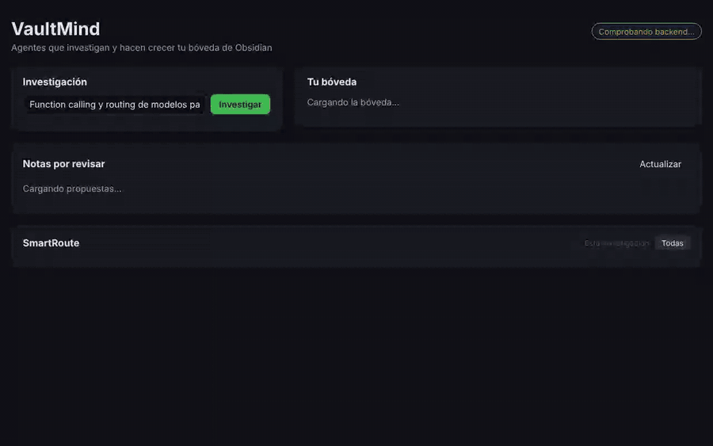

# VaultMind

Multi-agent research copilot that grows your Obsidian vault, routing each task between small and large LLMs to cut cost.



## 1. Qué es

**El problema:** escribir el estado del arte de un TFG lleva semanas, y la bóveda de Obsidian de un estudiante acaba llena de conceptos enlazados (`[[LoRA]]`, `[[Routing de modelos]]`) que nunca llegan a tener nota propia.

**Para quién:** estudiantes que toman sus apuntes en Obsidian y preparan un trabajo de investigación.

**Momento mínimo de valor:** escribes un tema y, en un minuto, un equipo de agentes te propone notas nuevas, con fuentes de arXiv y enlazadas a las que ya tenías, para que las apruebes con un clic.

## 2. Funcionalidades

### MVP

| HU | Historia de usuario | Backend | Frontend |
| --- | --- | --- | --- |
| HU1 | Como estudiante, quiero ver mi bóveda como grafo para entender cómo se conectan mis notas. | `GET /api/vault` | Grafo 3D de la bóveda; las notas propuestas aparecen animadas, con un anillo verde (SLM) o azul (modelo grande) según quién las escribió |
| HU2 | Como estudiante, quiero lanzar una investigación sobre un tema y ver a los agentes trabajar en directo para ampliar mi estado del arte. | `POST /api/research` + SSE | Pestaña «Agentes» con el razonamiento, las búsquedas y las decisiones del router en directo; reconexión explícita si se corta la conexión |
| HU3 | Como estudiante, quiero revisar y aprobar las notas antes de que entren en mi bóveda para no llenarla de errores. | `GET/POST /api/proposals` | Pestaña «Notas»: la nota renderizada con sus `[[enlaces]]` marcados según existan en la bóveda, sus fuentes y aprobar / rechazar |
| HU4 | Como estudiante, quiero ver qué modelo hizo cada tarea y cuánto costó para saber cuánto ahorra el router. | `GET /api/metrics` | Pestaña «Router»: ahorro total, % de tareas del SLM, escaladas, coste frente a «solo modelo grande» y tabla por tarea, de la investigación actual o de todas |

Las cuatro están hechas y con tests en backend y frontend.

Cómo trabajan los agentes en cada investigación:

1. **Explorador:** detecta las *lagunas* de la bóveda (conceptos enlazados que no tienen nota) y elige las más útiles para el tema.
2. **Investigador:** busca cada laguna en arXiv con un bucle ReAct (decide qué buscar y cuándo tiene suficiente) y resume lo encontrado.
3. **Redactor:** escribe una nota de Obsidian por laguna, enlazada con las notas existentes.
4. **Revisor:** cuenta qué afirmaciones están respaldadas y señala las dudosas antes de que el estudiante apruebe.

**SmartRoute** decide para cada llamada si basta un modelo pequeño (SLM) o hace falta uno grande, y escala al grande si el pequeño falla o su respuesta no pasa la validación.

### Backlog

- Simulador de tribunal: tres agentes que preguntan sobre las notas del TFG.
- Router aprendido a partir de las trazas y de las evals, en lugar de reglas fijas.
- Más fuentes de papers (Semantic Scholar) y evals de calidad automáticas en cada cambio de prompt.
- Sincronización directa con la bóveda real (plugin de Obsidian o Google Drive).

## 3. Cómo ejecutarlo

**URL pública:** <https://vaultmind-xymm.onrender.com>. En el plan gratuito de Render se duerme tras 15 minutos sin visitas: la primera carga puede tardar alrededor de un minuto. Funciona en **modo demo** (`DEMO_MODE=true`): reproduce una investigación grabada, así no necesita clave de API y ningún visitante puede gastar saldo. Para investigaciones reales, ejecútalo en local con tu clave.

**Requisitos:** Docker, o bien Python ≥ 3.12 con [uv](https://docs.astral.sh/uv/) y Node ≥ 22. También hay un DevContainer (Python 3.12, Node 24 y uv) para abrir el proyecto listo en VS Code.

**Variables de entorno:** copia [`.env.example`](.env.example) a `.env`. Para investigar de verdad basta con `LLM_API_KEY` (OpenRouter); los modelos por defecto son Qwen2.5 7B y 72B Instruct. Sin clave, pon `DEMO_MODE=true` (con `docker compose` es el valor por defecto).

```bash
# Con Docker (desarrollo): backend en :8000 y frontend en :5173
docker compose up --build
VAULT_DIR=/ruta/a/tu/boveda docker compose up      # con tu bóveda en lugar de la de demo

# Imagen de producción (un solo servicio: FastAPI sirve la API y el frontend) en :8080
docker compose --profile prod up --build prod

# Sin Docker
cd backend && uv sync && uv run uvicorn app.main:app --reload    # :8000
cd frontend && npm ci && npm run dev                              # :5173 (reenvía /api al backend)
```

**Tests:**

```bash
cd backend && uv run pytest && uv run ruff check .      # ningún test llama a un LLM ni a internet
cd frontend && npm test && npm run lint && npm run build
```

La CI (GitHub Actions) ejecuta todo lo anterior en cada PR y construye la imagen de producción comprobando que responde en `/api/health`. Más detalle del backend en [`backend/README.md`](backend/README.md).

## 4. Cómo se construyó con IA

Dos personas, cada una con su agente de código (Claude Code), siguiendo el flujo del curso: `main` y `develop`, una rama `feature/...` por historia de usuario, Conventional Commits y PR a `develop` revisada por la otra persona con la CI en verde.

### Agentes de código y reglas

- **`CLAUDE.md` / `AGENTS.md`:** propiedad del código por persona, flujo de Git, comandos y reglas que el agente debe cumplir (ningún test llama a un LLM ni a internet; nunca tocar `.env`; escritura en la bóveda solo en `_copilot/` y tras aprobación; las respuestas de la API deben cumplir `contracts/`).
- **Contrato primero:** los esquemas JSON de `contracts/` se acordaron el primer día. Backend y frontend avanzaron en paralelo sin esperarse: el frontend trabajó con `fixtures/run_example.jsonl`, una investigación grabada que un test mantiene coherente con el contrato.
- **Plan antes de programar:** cada tarea empezaba pidiendo al agente un plan corto (ficheros, tests, orden).

### Un prompt real

```text
Soy la Persona A: agentes y backend. Solo toco backend/, tests de backend y fixtures/.
No modifico frontend/ ni contracts/ sin avisar: si el contrato tiene que cambiar, para y dímelo.
[...]
REGLAS
- Ningún test llama a un LLM ni a internet: usa FakeLLMClient y respuestas grabadas en fixtures.
- Cada historia de usuario en su rama feature/huN-..., con tests, antes de abrir PR a develop.
[...]
TAREA DE HOY
HU2: agentes Explorador e Investigador (herramienta arXiv) y orquestador con límite de pasos.
Empieza con un plan corto (ficheros a crear, tests que escribirás y orden). Espera mi OK antes de programar.
```

### Lo que funcionó

- **No confiar al LLM lo que el código puede garantizar.** Las lagunas las detecta el parser; el LLM solo elige entre ellas. Las fuentes solo se aceptan si arXiv las devolvió. Los enlaces de una nota se resuelven contra la bóveda real.
- **Un `FakeLLMClient` guionizado** que falla si se acaba el guion: los tests de agentes son deterministas, gratis y no pasan en verde por casualidad.
- **Validar para escalar:** una respuesta del SLM con JSON roto o una herramienta inexistente se trata como un fallo y se repite con el modelo grande.
- **Una prueba de punta a punta** con el cableado de producción y la red simulada detectó que todas las piezas encajan antes de gastar un céntimo en APIs.
- **Tipos del frontend generados desde `contracts/`** (`npm run gen:types`) en lugar de escritos a mano; la CI falla si se desincronizan.
- **Producción como un solo servicio** (FastAPI sirve el frontend compilado): sin CORS ni una URL distinta por entorno.
- **Probar la interfaz en un navegador real** (Chromium sin interfaz, con Playwright) además de los tests: destapó fallos que los tests no veían (la cámara pegada a la última nota, fuentes duplicadas, un botón cortado en móvil) y sirvió para grabar el GIF de la demo.
- **Validar los colores con un script en lugar de a ojo:** «un color por agente» no superaba la separación para daltonismo junto al verde y el azul del modelo, así que las notas propuestas usan un único acento y los agentes se identifican por su nombre.

### Lo que costó

- Errores que los tests no veían: una ruta relativa que solo fallaba al arrancar el servidor desde otra carpeta y una regla del `.gitignore` que ignoraba en silencio `backend/vault/`. Lección: arrancar la app real y revisar `git status` además de pasar los tests.
- Decidir cómo contar el coste de una escalada (se cobra también el intento fallido del SLM, para no inflar el ahorro).
- El SSE no pintaba nada al principio: el backend envía `event: <tipo>` y `EventSource.onmessage` solo recibe mensajes sin tipo, así que hay que escuchar cada tipo con `addEventListener`.
- Compatibilidad de versiones: TypeScript 7 no es compatible con `typescript-eslint`, así que se fijó la 6.0. Y la regla de React que prohíbe actualizar estado de forma síncrona dentro de un efecto obligó a reorganizar la carga de datos de los paneles.

El registro completo está en [`docs/ai-log.md`](docs/ai-log.md).

## 5. Estado y próximos pasos

**Estado:** las cuatro historias del MVP están implementadas en backend y frontend, con más de 260 tests (más de 200 en el backend y 58 en el frontend, incluida una prueba de punta a punta con la red simulada) y la app completa verificada en un navegador real en modo demo.

**Modelos:** Qwen2.5 7B Instruct como SLM y Qwen2.5 72B Instruct como modelo grande (misma familia, para que la comparación mida el efecto del tamaño), con sus precios de OpenRouter.

**Pendiente:**

- Ejecutar las evals (`backend/evals`) con una clave para obtener la tasa de acierto y el ahorro reales. El 31 % de ahorro de la demo usa precios reales pero tokens de ejemplo: es ilustrativo.

**Próximos pasos:** ver el backlog de la sección 2.
